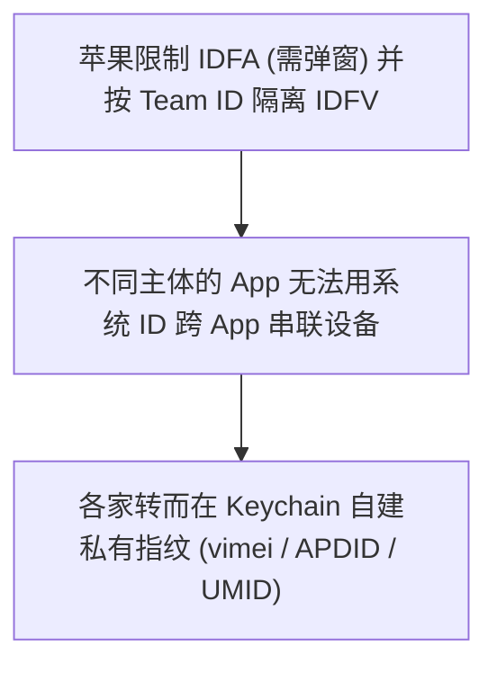

# 从 75ms 扫描窗口到自建设备指纹:一次 iOS App 动态逆向实录

> 声明:本文仅供移动安全技术研讨。测试对象为闲鱼 iOS 客户端 7.28.60,环境为两台越狱设备(iPhone 14 Pro / iOS 16.3,iPhone 11 Pro Max / iOS 26,均 RootHide)。文中设备标识符均已脱敏,不含任何闭源代码。

---

## 0x01 起因

给闲鱼挂 Frida 的时候,我注意到两个现象。

冷启动,什么都不点,界面还没画完。探针在 75ms 内连续抓到了 50 多次 `-[UIApplication canOpenURL:]`。

同时,抓包里冒出一个看着像个人博客的陌生域名:`*.puata.info`。

我决定把这段初始化的调用链扒开看看。

---

## 0x02 工具链

- **静态**:Ghidra,提取 Mach-O 字符串、类导出表、交叉引用。
- **动态**:Frida + objection,挂钩 Keychain、系统调用、硬件属性 API、URL scheme 探测。
- **核对基准**:闲鱼官方《隐私政策》《第三方 SDK 共享清单》,以及它鸿蒙版、安卓版的权限说明。

一个前提:我手上只有自己写的脚本和设备跑出来的数据,没有闲鱼的源码。下面每条"实测"结论,原始证据都来自设备,不是我凭空推的。

---

## 0x03 核心发现

### 1. 批量枚举应用列表(75ms 探测窗口)

Hook 掉 URL 处理入口,抓冷启动初期的调用:

```javascript
Interceptor.attach(ObjC.classes.UIApplication["- canOpenURL:"].implementation, {
  onEnter: function (args) {
    var url = new ObjC.Object(args[2]).absoluteString().toString();
    send({ type: "canOpenURL", url: url, ts: Date.now() });
  }
});
```

启动后第 52 秒,一个没有任何交互的时段,探针炸了。75ms 内,`canOpenURL:` 被连续调了 50 多次,挨个探测我装了哪些 App。节选实测时序(偏移从突发起点算起):

| 偏移 (ms) | Scheme | 对应 App |
| :--- | :--- | :--- |
| +0 | `snssdk141://` | 今日头条 |
| +4 | `snssdk35://` | 西瓜视频 |
| +9 | `baiduboxapp://` | 百度 |
| +15 | `taobaoliveshare://` | 淘宝直播 |
| +16 | `imrocketshare://` | 多闪 |
| +33 | `weixin://` | 微信 |
| +72 | `xhsdiscover://` | 小红书 |
| +75 | `wireless1688://` | 1688 |

全程覆盖短视频、社交、电商、地图各类主流 App。解包 `Info.plist`,它配置的 `LSApplicationQueriesSchemes` 刚好 50 多个,和这批探测目标 100% 吻合（完整 50 个应用清单对照见 [`data/scanned_apps.md`](../data/scanned_apps.md)）。

**结论**:走系统白名单探测,技术上符合 iOS 规则,属于行业通行做法;SDK 清单也声明了收集应用列表。但有个披露缺口——鸿蒙版权限说明里明确写了"获取应用列表"这项能力,iOS 版权限说明没写。同一家、同一份东西,两个平台说法不一致。

---

### 2. 自建虚拟标识:vimei / vimsi / udid

Apple 从 iOS 5 起就淘汰了 UDID,iOS 7 起彻底禁止 App 读物理 IMEI/IMSI。但我发现闲鱼往 Keychain 写了三个键:`vimei`、`vimsi`、`udid`。

反汇编追写入逻辑(还原):

```arm64
; 虚拟串号生成
adrp  x1, 0x104b2c000     ; "randomStrWithCount:"
mov   x2, #0xf            ; 参数:15 位
bl    _objc_msgSend       ; 返回伪随机串,如 "9o2r****"

; 写进 Keychain
adrp  x0, 0x104b50000     ; @"vimei"
bl    _SecItemAdd
```

光看代码调了 `randomStrWithCount:`,还不能下"伪随机"的结论——这函数名可能骗人,万一它拿设备特征当种子,那每次"随机"出来都是同一个,名字叫 random 实则确定性派生。

所以我做了删除复活测试:记录原值 → 抹掉 Keychain → 卸载重装 → 看新值。

| 字段 | 原值 | 重装后新值 | 长度 |
| :--- | :--- | :--- | :--- |
| `vimei` | `pa1r****` | `w1ca****` | 15 位 |
| `vimsi` | `vzj1****` | `zzzb****` | 15 位 |
| `udid` | `fzsd****` | `62jv****` | 30 位 |

三项全变成无规律新值,新记录的创建时间正好对应重装那一刻。

同一台设备,如果是硬件派生,重算必然相同;实测全变 → 排除硬件派生。它就是本地伪随机生成的,能重置。

**结论**:vimei/vimsi 是伪随机串号,可重置、跟硬件无关。真正的问题不在"能不能重置",而在它自造了一套"虚拟 IMEI/IMSI"写进 Keychain 做跨安装持久化,却没在任何隐私文档里跟用户提过。

---

### 3. IDFV 的 Team ID 隔离

这块我本来猜错了,是实测把我纠正过来的。

我原以为阿里系 App 共享同一个 IDFV(毕竟都是阿里),装着淘宝就没法重置。于是在同一台手机上取了三个 App 的 IDFV 对比:

| App | Bundle ID | Team ID | IDFV(脱敏) |
| :--- | :--- | :--- | :--- |
| 闲鱼 | `com.taobao.fleamarket` | `43Y657P48S` | `A8F7****` |
| 手机淘宝 | `com.taobao.taobao4iphone` | `VJGTV94XY8` | `560E****` |
| 支付宝 | `com.alipay.iphoneclient` | `8H6B3SFEU4` | `F70E****` |

三个 Team ID 全不同,三个 IDFV 也全不同。

更直接的证据:在装着淘宝的情况下卸载闲鱼、重装,闲鱼拿到的是一个全新 IDFV,没有继承淘宝的。

这说明 iOS 对 App Store 应用的 vendor 判定是按签名主体(Team ID)来的,不是按 bundle 前缀。闲鱼、淘宝、支付宝签约主体各不相同,系统把它们当成互不相干的开发商,IDFV 彼此隔离。

有意思的是,这反而解释了大厂为什么要自己造指纹:



**结论**:正因为系统 IDFV 跨不了主体、还能被用户卸载重置,厂商才各自造了一套私有指纹来打补丁。系统的隔离,逼出了自建指纹。

---

### 4. 陌生域名 puata.info 是谁

启动时网络频繁访问 `*.puata.info`。域名长得不像阿里,我追了它的归属。

两条证据对上了:

1. **二进制里的编译路径残留**:Mach-O 字符串池里搜 `puata`,命中 `/Users/.../UMCommon_iOS/.../UMNetworkWork.m`,调用类全是 `UM` 前缀。
2. **ICP 备案**:`puata.info` 备案主体是北京锐讯灵通科技有限公司,和 `umengcloud.com`、`umtrack.com` 同一主体——都是友盟。

**结论**:这是友盟统计 SDK 的数据上报域名,不是什么木马。但它用了跟品牌无关的小众域名上报,普通人和常规工具不太容易把它和友盟对上号。

(顺带说一句:我一开始怀疑它是"刻意伪装的隐蔽域名"。后来发现这域名在好几个 App 的公开 SDK 清单里都列着,算不上隐蔽,就收回了这个说法。)

---

### 5. 自保护机制

App 里有一套挺完整的自保护:

- 查常见越狱文件(`/Applications/Cydia.app`、apt、ssh 等)是否存在。
- 读 `CFNetworkCopySystemProxySettings` 看有没有挂抓包代理。
- 用 svc 直系统调用绕过符号,防常规 hook。

**结论**:这些属于金融、电商类 App 标准的运行时自保护,目的是防自动化黑灰产、防刷单,是"检测环境可不可信",不算侵犯隐私。(它确实挺碍事——spawn 经常被反调试杀掉,代理一挂抓包就失效。)

---

## 0x04 真正值得说的几条

把行业惯例剔掉,实测下来真正站得住的问题就这几条:

1. **自建标识没披露**:本地生成 15 位随机 `vimei`/`vimsi` 存进 Keychain 做持久化,隐私文档里一个字没提。
2. **跨平台披露双标**:鸿蒙版权限说明写了获取应用列表,iOS 版没写。
3. **用途声明有偏差**:IDFA 声明用于开屏广告,但实测在没广告的风控初始化里也被读取。
4. **真正的追踪在云端**:本地把 vimei、IDFV 全 hook 成假的也没用。只要公网 IP 和硬件机型没变,清掉所有本地缓存后输入密码照样秒登录——设备指纹的核心早搬到服务端了,靠硬件组合特征加网络关系做聚类,这层本地碰不到。

---

## 0x05 没做到的

- **wua / x-sign 是黑盒**:阿里无线保镖的签名载荷用了混淆和白盒密码学,明文构成本地没能逐字段坐实。
- **服务端是盲区**:云端怎么聚类设备、各特征占多少权重,客户端只能靠输入输出反推,没法下定论。

---

## 0x06 写在最后

这次就扒到这。`wua` 那块签名还没啃下来,服务端怎么聚类也只能靠猜,后面有进展再更。

数据和脚本都在上面,有错欢迎指正。
